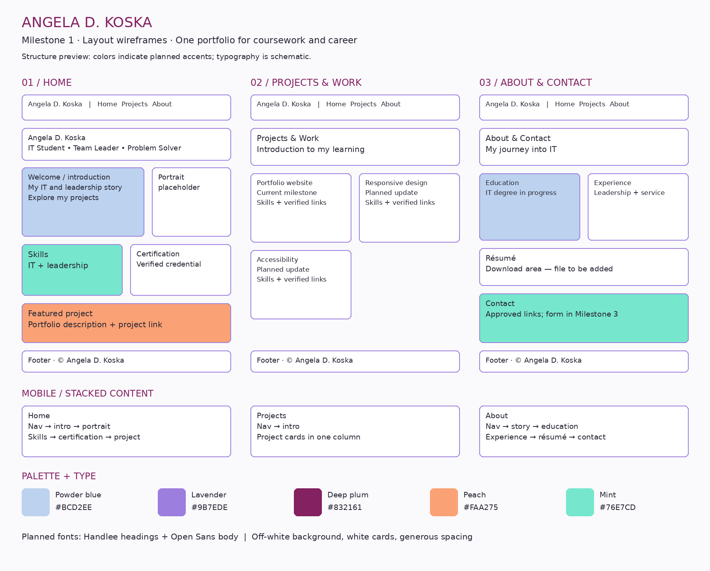

# Angela D. Koska — Personal Portfolio

## Purpose and audience
One website for my personal portfolio and web development assignments. It helps prospective employers see my developing IT skills, leadership experience, and coursework. Each milestone extends these same three pages.

## Milestone 1: Site plan and HTML skeleton
- `index.html`: Home, introduction, portrait placeholder, skills, certification placeholder, and featured project.
- `projects.html`: Current portfolio project and clearly marked planned coursework updates.
- `about.html`: Personal background, education, experience, and placeholders for résumé and contact information.
- `wireframe.png`: Desktop and mobile layout plans for all three pages, with palette and font notes.

All three pages have shared navigation, working relative links, logical h1–h3 headings, and semantic HTML. The Milestone 1 foundation is retained in Git history. Milestone 2 adds the shared responsive stylesheet; later updates add the headshot, certificate, November 2026 resumé PDF, repository links, and a practice contact form.

## Wireframe

## Visual direction
Light and airy: off-white backgrounds, white cards, generous spacing, rounded corners, and restrained color accents.

| Color | Hex | Planned role |
|---|---|---|
| Powder blue | #BCD2EE | Soft section backgrounds |
| Lavender | #9B7EDE | Decorative details and borders |
| Deep plum | #832161 | Headings, navigation accents, and buttons |
| Peach | #FAA275 | Featured project accents |
| Mint | #76E7CD | Skills and certification highlights |

Planned Google Font pairing: Handlee for headings, Open Sans for body text, with suitable system fallbacks. Fonts are loaded on all three pages. Use dark body text on light backgrounds and verify each actual text/background pairing before applying the palette. Do not assume every palette pairing passes contrast.

## Layout plan
Home: name and tagline; introduction beside portrait; skills and certification; featured project.
Projects: introduction; project cards with descriptions, skills, status, and verified links.
About: personal story and education; relevant experience; résumé; contact area.
Shared navigation and footer appear on every page. Mobile layouts stack content and allow navigation to wrap.

## Open and review
1. Extract the ZIP.
2. Open `index.html` in a browser.
3. Follow navigation to Projects & Work and About & Contact.
4. View `wireframe.png` for the planned styled layout.

## Submit Milestone 1
Upload these files and the wireframe image into the existing portfolio repository, keeping the three HTML files at its root. Commit them as the Milestone 1 foundation. Submit the GitHub repository URL, with the HTML files and wireframe visible. Keep this commit in history before continuing to styling.

## Milestone 2: Styled and responsive
Implemented in `styles.css`, linked from all three pages:
- The chosen palette, Handlee headings, and Open Sans body text.
- Type selectors (`body`, `section`), class selectors (`.page-layout`, `.button`), and an ID selector (`#main-content`).
- An 8px-based spacing system, rounded cards, and visible keyboard focus.
- Flexbox navigation and Grid page/project layouts.
- Media queries at 768px and 1100px; mobile is the default layout.
- Later updates added an optimized portrait and Microsoft Office Specialist certificate image under `assets/`.

### Milestone 2 review
Angela confirmed the site is live and reported that the pages looked good after the requested screen-size checks.

Live site: https://angelakoska.github.io/my-portfolio/

## Milestone 3: Accessibility and intentional design

### 1. Accessibility fixes

- Kept one h1 per page, logical heading order, descriptive main navigation, and aria-current to orient readers.
- Added a skip link to the main content and made its destination focusable for keyboard users.
- Added visible labels explicitly associated with every contact form field.
- Grouped related form fields in a fieldset with a descriptive legend.
- Connected help and error text to their fields with aria-describedby and marked invalid fields with aria-invalid plus a dashed border.
- Moved keyboard focus to the first invalid field and used a polite live status message to announce validation results.
- Shortened the certificate image alt text and kept the credential name and date in its visible caption to avoid repeating a long description.
- Kept visible keyboard focus outlines and contrasting control borders.

### Fresh WAVE audit — November 14, 2026

| Page | Errors | Contrast errors | Alerts |
|---|---:|---:|---|
| Home | 0 | 0 | 1 redundant link |
| Projects & Work | 0 | 0 | 1 redundant link |
| About & Contact | 0 | 0 | 1 redundant link; 1 PDF link; 1 noscript notice |

WAVE found no errors or contrast errors on any page. The redundant-link alert is the site name and Home link sharing a destination; the PDF alert identifies the résumé download; the noscript notice explains the form’s JavaScript requirement. These are review alerts, not WAVE errors. The refreshed Home scan also confirmed the shorter certificate alt text no longer triggers a long-alt alert.

### 2. Intentional visual design

The same color palette, fonts, navigation, and card styles are used on all three pages.

| Color | Hex | Role |
|---|---|---|
| Powder blue | #BCD2EE | Soft section and portrait backgrounds |
| Lavender | #9B7EDE | Decorative details and borders |
| Deep plum | #832161 | Headings, links, navigation accents, and buttons |
| Peach | #FAA275 | Featured project accents |
| Mint | #76E7CD | Skills and certification accents |
| Off-white | #FAF9FC | Page background |

- **Proximity:** Each project card keeps its title, description, skills, and link together, while spacing separates different projects; form labels and help text sit beside their fields.
- **Similarity:** Repeated plum buttons, heading fonts, rounded cards, navigation, and spacing show which elements have related roles.
- **Common region:** Card borders group related page content, and the contact fieldset gathers the form controls into one task.

### WebAIM Contrast Checker results

I checked every text/background pair used by the stylesheet in the [WebAIM Contrast Checker](https://webaim.org/resources/contrastchecker/). All normal-text combinations pass WCAG AA at 4.5:1 or higher; the muted input border also exceeds the 3:1 non-text component threshold.

| Foreground | Background | Ratio | WCAG AA |
|---|---|---:|---|
| #292735 | #FFFFFF | 14.6:1 | Pass |
| #292735 | #FAF9FC | 13.9:1 | Pass |
| #292735 | #EDF3FB | 13.1:1 | Pass |
| #292735 | #BCD2EE | 9.46:1 | Pass |
| #292735 | #FFF0E7 | 13.1:1 | Pass |
| #292735 | #F4F0FB | 13.0:1 | Pass |
| #292735 | #EAFBF6 | 13.6:1 | Pass |
| #832161 | #FFFFFF | 8.91:1 | Pass |
| #832161 | #FAF9FC | 8.50:1 | Pass |
| #832161 | #EDF3FB | 7.98:1 | Pass |
| #832161 | #BCD2EE | 5.77:1 | Pass |
| #832161 | #FFF0E7 | 8.01:1 | Pass |
| #832161 | #F4F0FB | 7.94:1 | Pass |
| #832161 | #EAFBF6 | 8.33:1 | Pass |
| #595467 | #FFFFFF | 7.26:1 | Pass |
| #595467 | #FAF9FC | 6.93:1 | Pass |
| #FFFFFF | #832161 | 8.91:1 | Pass |
| #FFFFFF | #67204F | 11.0:1 | Pass |
| #A11832 | #FFFFFF | 7.80:1 | Pass |

### 3. Accessible contact form

The About & Contact page includes associated labels, a fieldset and legend, required-field instructions, linked hints and field-specific errors, aria-invalid states, keyboard focus management, and a live status message. The form validates entries locally, does not transmit or store them, and never claims a message was sent.

### Verification notes

- WAVE was run on all three live pages; all have zero errors and zero contrast errors.
- The WebAIM Contrast Checker was used for all 19 text/background combinations listed above.
- Existing code checks include unique IDs, valid ARIA references, form labels, JavaScript syntax, and validation behavior for empty, invalid, corrected, valid, and maximum-length entries.
- Earlier responsive checks covered 320px, 768px, and 1200px; screen-reader testing is not claimed.
- WAVE is an automated audit and does not by itself establish complete accessibility compliance.
